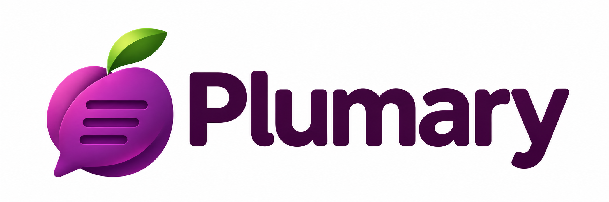

<p align="center">
  
</p>

Open-source, backend-free writing assistant. You pick the providers (Claude, OpenAI, Ollama, DeepL, LanguageTool...), your text goes only where you configured, and anyone can add a provider plugin.

## Layout

| Path | What |
|---|---|
| `packages/core` | Platform-agnostic engine: plugin contract, suggestion model, chunking, cache, merge, shared LLM prompt + parser. Zero deps; builds to ESM and a single-file IIFE for embedding in JavaScriptCore/QuickJS. |
| `packages/providers/*` | Built-in providers. Pure TS, `fetch` only. |
| `apps/cli` | Smoke-test CLI. |

Platform hosts (macOS Tauri + Swift Accessibility, browser extension, mobile) implement the `TextHost`, `SecretStore` and `SettingsStore` ports from `core`.

## Try it

```sh
pnpm install && pnpm build && pnpm test

# local model
ollama pull llama3.2
echo "I has a apple. She go home yesterday." | node apps/cli/dist/index.js --provider ollama

# Claude
export ANTHROPIC_API_KEY=sk-ant-...
echo "I has a apple." | node apps/cli/dist/index.js --provider anthropic --caps grammar,spell,rephrase
```

## Writing a provider

```ts
import type { Provider } from '@plumary/core'
export default {
  id: 'my-provider', name: 'My provider',
  capabilities: ['grammar'],
  settingsSchema: { type: 'object', properties: { apiKey: { type: 'string', title: 'API key', secret: true } } },
  async run(request, ctx) { /* return Suggestion[] with ranges into request.text */ },
} satisfies Provider
```
